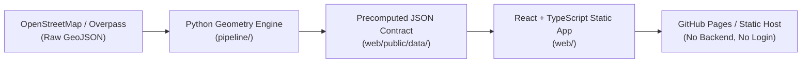

# PGA Tour Course Viewer & Hole Feature Extractor

> Interactive, vector-based golf course yardage books and hole-by-hole routing, powered by OpenStreetMap data and an offline Python geometry engine.

A zero-backend static web application designed for browsing championship golf courses, exploring detailed vector hole layouts, and simulating shot strategies.

---

## Architecture Overview



- **Pipeline (`pipeline/`)**: Python offline build tool that downloads OpenStreetMap course data, computes transverse Mercator projections, normalizes hole orientations (Hole-Up / North-Up), and generates validated, self-contained JSON assets.
- **Web Client (`web/`)**: High-performance React 18 + TypeScript single-page application that renders SVG layers natively with pan/zoom, yardage arcs, hazard tooltips, and a session-only multi-shot planner.

---

## Shipped Courses

The web application ships pre-rendered JSON assets for 4 championship venues:

| Course Name | Holes | Par | Total Yards | Shipped JSON Size |
|---|---|---|---|---|
| **Augusta National Golf Club** | 18 | 72 | 7,595 yds | 708 KB (~115 KB gzip) |
| **Pebble Beach Golf Links** | 18 | 72 | 7,033 yds | 608 KB (~98 KB gzip) |
| **Quail Hollow Club** | 18 | 71 | 7,320 yds | 507 KB (~82 KB gzip) |
| **TPC Sawgrass (THE PLAYERS Stadium Course)** | 18 | 72 | 7,202 yds | 582 KB (~94 KB gzip) |

---

## Key Features

1. **Course Dashboard / Picker**: Landing page listing courses with official tournament tags (Masters, U.S. Open, PGA Championship, The Players), total holes, par, and yardage.
2. **Whole-Property Overview**: Spatial property view with continuous turf rough, fairways, greens, tees, water hazards, bunkers, centerlines, and interactive confirmation popups.
3. **Overhead Yardage Book**: Pure SVG layered rendering with auto-rotated Hole-Up view (tee at bottom, green at top) and North-Up toggle.
4. **Pan & Zoom Engine (`usePanZoom`)**: Mouse drag-to-pan, cursor-anchored wheel zoom, boundary clamping with soft margin damping (tanh rubber-band), animated snap-back, and zoom controls.
5. **Yardage Arcs & Carry Distances**: Distance rings (100, 150, 200, 250 yds) from the pin, and hazard carry tooltips on hover.
6. **Session-Only Multi-Shot Planner**:
   - Sequential shot target placing.
   - Draggable numbered shot markers.
   - Per-shot distances ("Drive", "Shot 2"...) and remaining distance "🚩 To Pin".
   - Undo and Clear All.
   - **Zero persistence**: shots are kept in session component state only and reset on hole change.
7. **Keyboard Navigation**:
   - `ArrowRight` / `PageDown`: Next Hole
   - `ArrowLeft` / `PageUp`: Prev Hole
   - `Escape`: Cancel targeting mode / dismiss popups

---

## Quickstart

### 1. Web Application (Frontend)

```bash
cd web
npm install
npm run dev
```

Open `http://localhost:5173` to browse the course library locally.

To test and build for production:

```bash
npm test        # Run Vitest unit tests
npm run build   # Typecheck and build static distribution in web/dist
```

### 2. Build Pipeline (Python)

Adding or refreshing a course is a one-command step:

```bash
# Add or refresh a course by name
python pipeline/scripts/build_site_data.py "Quail Hollow Club"

# Rebuild all cached courses from data/
python pipeline/scripts/build_site_data.py --all

# Force re-download fresh OSM data
python pipeline/scripts/build_site_data.py "TPC Sawgrass" --force
```

For detailed instructions and data quality warnings, see [docs/ADDING_A_COURSE.md](docs/ADDING_A_COURSE.md).

---

## Testing & Quality Assurance

Both the Python pipeline and React frontend maintain automated test suites:

```bash
# Run Python pipeline tests (domain geometry, schema validation, atomic writes)
python -m unittest discover pipeline/tests

# Run React frontend tests (Zod validation, pan/zoom math, shot planner, 4-course parity)
cd web
npm test
```

For the 1:1 feature parity breakdown against the legacy viewer, refer to [docs/PARITY_CHECKLIST.md](docs/PARITY_CHECKLIST.md).

---

## Security & Privacy

- **Static Architecture**: Hosted statically with no backend, no database, and no runtime API calls.
- **Content-Security-Policy**: Enforced via `<meta http-equiv>` and `_headers` (`default-src 'self'`).
- **No Untrusted Injection**: All SVG paths are bound to native `d` attributes; `dangerouslySetInnerHTML` is never used.
- **Session Privacy**: The shot planner stores all points in transient React state without writing to `localStorage`, cookies, or URL query parameters.

---

## Licensing & Attribution

- **Map Data**: Derived from OpenStreetMap. &copy; OpenStreetMap contributors under the Open Database License ([ODbL 1.0](https://opendatacommons.org/licenses/odbl/1-0/)). See [DATA_LICENSE.md](DATA_LICENSE.md).
- **Application Code**: Licensed under the project repository terms.
